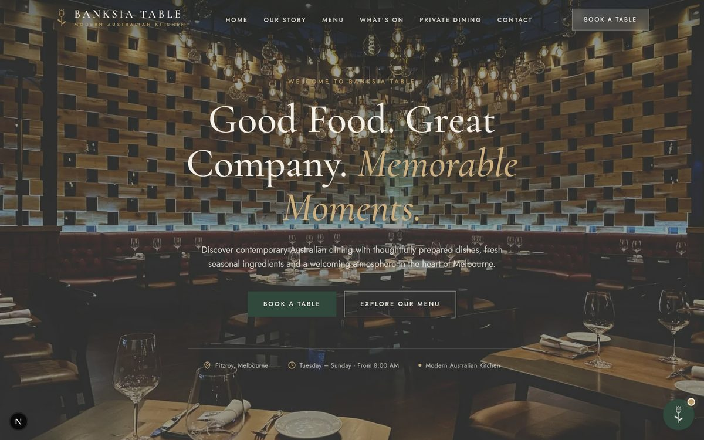

# Banksia Table — Modern Australian Kitchen

A modern Australian restaurant concept website set in Fitzroy, Melbourne — built as a
portfolio demonstration for **M-WebCraft Studio**.

> **Disclaimer:** Banksia Table is a fictional restaurant. All menu items, prices, opening
> hours, events and contact details are illustrative demonstration content created for
> website portfolio purposes only.



## Features

- **Sticky responsive navigation** — transparent-to-solid transition on scroll, full-screen
  animated mobile menu
- **Hero section** — editorial serif typography over warm dining-room photography
- **Interactive menu** — 5 switchable categories (Breakfast, Small Plates, Main Courses,
  Desserts, Drinks) with dietary labels (V / VG / GF) and a legend
- **Featured dishes** — signature plates with photography and demonstration pricing
- **What's On** — recurring in-house events section
- **Dining experience gallery** — masonry-style image grid with captions
- **Reservation form** — client-side validation: Australian phone format, auto-formatted
  DD/MM/YYYY dates, Monday-closed detection, per-day time slots, guest count
- **Private Dining** — event cards with an enquiry button that pre-selects the enquiry type
  in the contact form
- **Hours & location** — fictional opening hours with a Google Maps placeholder
- **Contact / enquiry form** — validation with a demonstration success state
- **FAQ** — 7-question accessible accordion
- **"Banksia Table Assistant" chatbot** — floating widget with quick replies and scripted
  responses (clearly labelled as a simulated demo assistant)
- **SEO ready** — metadata, OpenGraph/Twitter cards and JSON-LD restaurant schema

## Tech stack

| Layer      | Choice                                        |
| ---------- | --------------------------------------------- |
| Framework  | Next.js 16 (App Router) + TypeScript          |
| Styling    | Tailwind CSS 4                                |
| UI         | shadcn/ui accordion + Lucide icons            |
| Fonts      | Cormorant Garamond (display) · Jost (body)    |
| Deployment | Vercel-ready (no environment variables needed) |

## Getting started

```bash
# install dependencies (npm, pnpm or bun all work)
npm install

# run the development server
npm run dev

# production build
npm run build && npm start
```

Open [http://localhost:3000](http://localhost:3000) to view the site.

## Deploying to Vercel

1. Push this repository to GitHub.
2. On [vercel.com](https://vercel.com), choose **Add New → Project** and import the repo.
3. Vercel auto-detects Next.js — no environment variables or custom settings are required.
4. Click **Deploy**.

## Credits

Designed By [M-WebCraft Studio](https://m-webcraft-studio-1kdt.vercel.app/)

---

© 2026 Banksia Table. Concept Website Demonstration.
